# RestroFlow System Documentation

Prepared: 13 October 2026 | ITELEC 4100 | First Semester AY 2026-2027

ITELEC 4100 - Advanced Web Development | Final Term Project

First Semester, Academic Year 2026-2027 | Prepared 13 October 2026

Prepared by: ____________________    Section: ____________________

Reference: Final Project.docx.pdf. This document describes the implemented restaurant system, its workflows, architecture, permissions, setup, and validation.

Screenshots are actual browser captures from an isolated SQLite test environment. All displayed accounts, contact numbers, and records are demonstration data. No application secrets, OTP values, or passwords are included.

Reading guide: system overview and access rules; installation and architecture; fourteen illustrated screens; testing and project-requirement mapping.

## 1. System overview and access rules

RestroFlow supports customer orders and table reservations, with restaurant record management for administrators and inventory tasks for staff. It uses Laravel, React, Inertia.js, Fortify, and Spatie Roles and Permissions.

| Account | Allowed operations | Restrictions |
| --- | --- | --- |
| Admin | View and manage all orders, reservations, and inventory; confirm reservations. | Password authentication required; no registration OTP challenge on admin login. |
| Customer / legacy Viewer | Create orders and reservations; view own records and totals. | Cannot edit/delete records, set status, view inventory, or read another account's history. |
| Staff | View/create/update inventory; create/view/update own orders. | Cannot delete records, read others' orders, or access reservations. |

New registrations receive Customer access. Public requests cannot select an elevated role. The server sets record ownership and customer status; customers cannot spoof another user_id or mark a reservation Confirmed.

Legacy orders/reservations without an owner remain visible only to Admin. They are not assigned to accounts by matching names.

## 2. Setup and operation

Requirements: PHP 8.2 or later with the project's required extensions, Composer, Node.js/npm, and MySQL for the local application. Browser tests use their own SQLite database. Use the installed lock files for dependency versions.

| Step | Action |
| --- | --- |
| 1. Dependencies | Run composer install and npm install from the project folder. |
| 2. Environment | For a new installation, copy .env.example to .env, configure database/APP_URL/mail values, then run php artisan key:generate. Keep the existing APP_KEY when updating this installation. |
| 3. Database | Run php artisan migrate --seed. Migrations preserve legacy restaurant records; role seeding defines Admin, Staff, Customer, and Viewer. |
| 4. Frontend and server | Run npm run build, then php artisan serve. For frontend development use npm run dev. |
| 5. Account roles | Register and verify a real email. A server administrator can run php artisan app:set-role email@example.com Admin (or Staff/Customer/Viewer). |
| 6. Email | Configure SMTP using your provider's settings and run php artisan config:clear. MAIL_MAILER=log writes local test messages instead of delivering email. |

## 3. Architecture and database design

Request flow: browser React page -> Laravel web middleware -> resource controller -> RestaurantRecords service -> Eloquent model/database -> JSON or Inertia response -> React interface.

| Layer | Main files / responsibilities |
| --- | --- |
| Presentation | resources/js/Pages, RecordForm, DataTable; app.jsx uses createInertiaApp and resolvePageComponent; app.blade.php includes Vite and Inertia directives. |
| Routing and controllers | routes/orders.php, reservations.php, inventory.php, otp.php; Order/Reservation/Inventory controllers inherit the standard resource methods. |
| Services and authentication | RestaurantRecords centralizes validation, ownership checks and queries. Fortify owns login/register/logout/reset; EmailOtp handles registration-code sending. |
| Persistence | User, Order, Reservation, MenuItem, RestaurantTable, InventoryItem; fillable fields, foreign keys and timestamp migrations. |

Relationships: User has many Orders and Reservations. Order belongs to User, MenuItem, and RestaurantTable. Reservation belongs to User and RestaurantTable. MenuItem and RestaurantTable expose inverse hasMany relationships.

Order/reservation user_id is nullable for legacy data. Deleting a user clears ownership rather than deleting restaurant history. Menu/table references protect historical records. New audit timestamps preserve unknown legacy values as null.

## 4. Sign in

Enter the account email or assigned username and password, then choose Sign in. Verified accounts sign in without another OTP. Admin accounts remain exempt from OTP. Wrong credentials are rejected and repeated attempts are throttled.

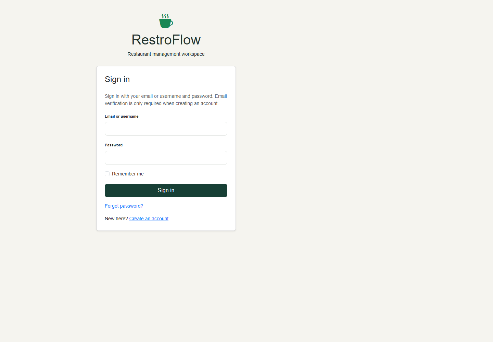

## 5. Request a password reset

Choose Forgot password from the login screen and enter the account email. Fortify sends a reset link. The linked Reset Password page accepts a new password and confirmation; the backend checks expiry and rejects reused or invalid tokens. This screenshot documents the request form, not proof of live inbox delivery.

## 6. Register a customer account

Enter name, email, password of at least eight characters, and confirmation. Registration creates a Customer account and starts email verification. Requested role or permission values cannot elevate the account.

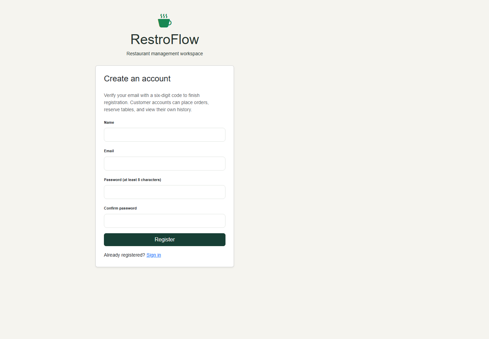

## 7. Verify registration email

Enter the six-digit code to finish registration. Codes expire after ten minutes; resend is limited to once per minute and verification attempts are limited. An unfinished registration must be verified before sign-in. The code itself is omitted from this screenshot.

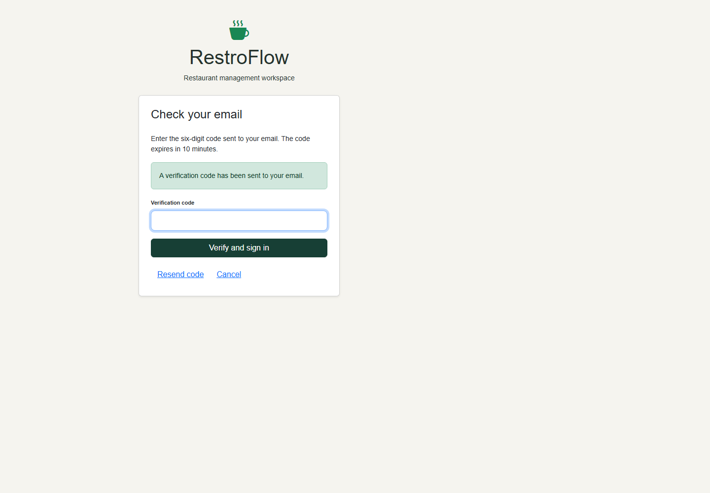

## 8. Place a customer order

Choose a menu item, optional table or takeout, and quantity. Save Order creates a Pending order for the signed-in customer. The backend computes the total from the stored menu price and ignores any submitted owner or status override.

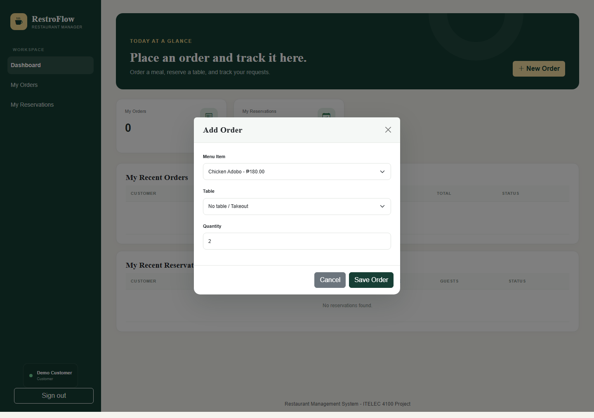

## 9. Reserve a table

Enter a phone number, choose a table, specify guests, date, and time, then select Save Reservation. Ownership and Pending status are assigned by the server. The captured number is fictitious demo data.

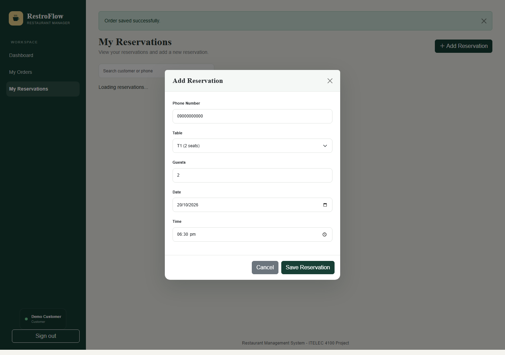

## 10. View personal reservations

My Reservations lists only the signed-in customer's reservations. The customer can search and create reservations but cannot edit or delete them. Admin manages confirmation and status changes.

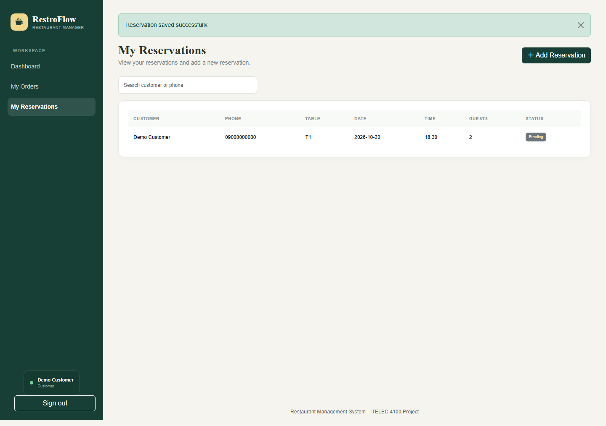

## 11. View personal orders

My Orders displays only the current account's orders, including item, quantity, total and status. The same ownership filter applies to direct API requests and individual resource links.

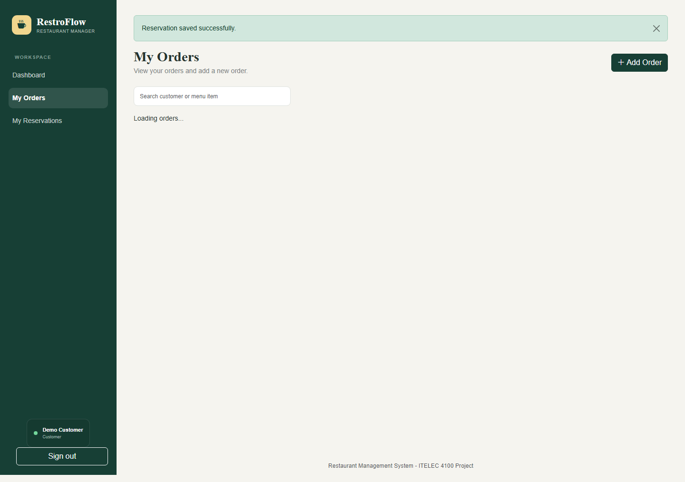

## 12. Customer dashboard

The dashboard shows personal counts, recent orders, and recent reservations. Inventory and global restaurant records are not available to the customer. Navigation provides My Orders and My Reservations.

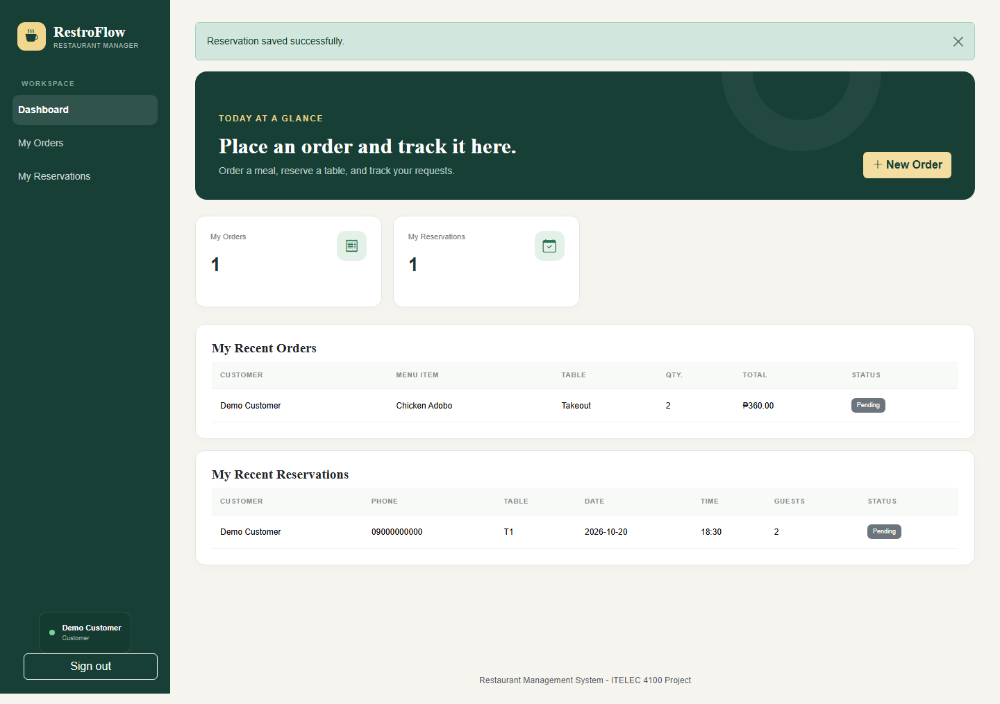

## 13. Administrator dashboard

Admin receives global counts and recent orders/reservations. Admin can navigate to restaurant-wide orders, reservations, and inventory. These records come from the isolated documentation database.

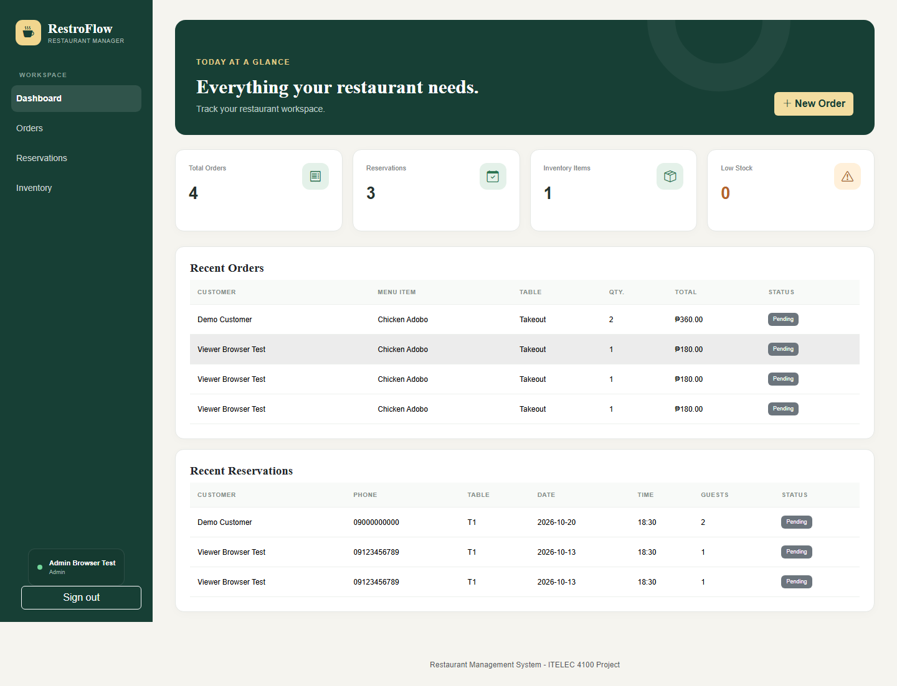

## 14. Confirm a reservation

Open a reservation using Edit Reservation, choose Confirmed, and save. Admin may manage reservation status; customer forms do not expose this selector and backend rules enforce the restriction.

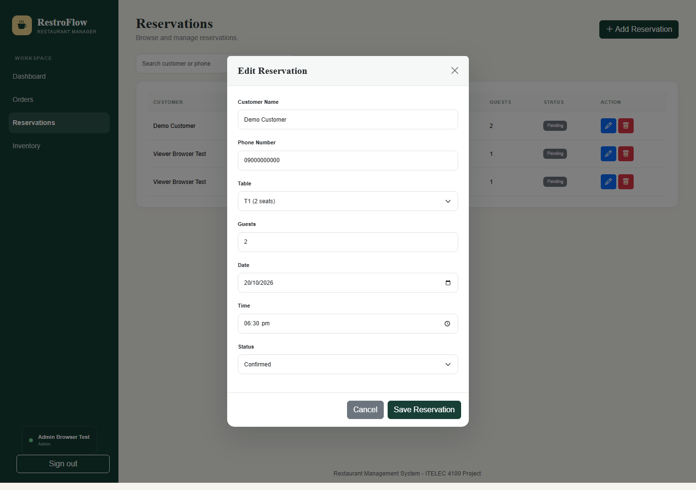

## 15. Manage all reservations

The Admin reservations list includes records from different customers. Admin can search, create, edit, or delete. Customers see only their own entries and do not receive these management actions.

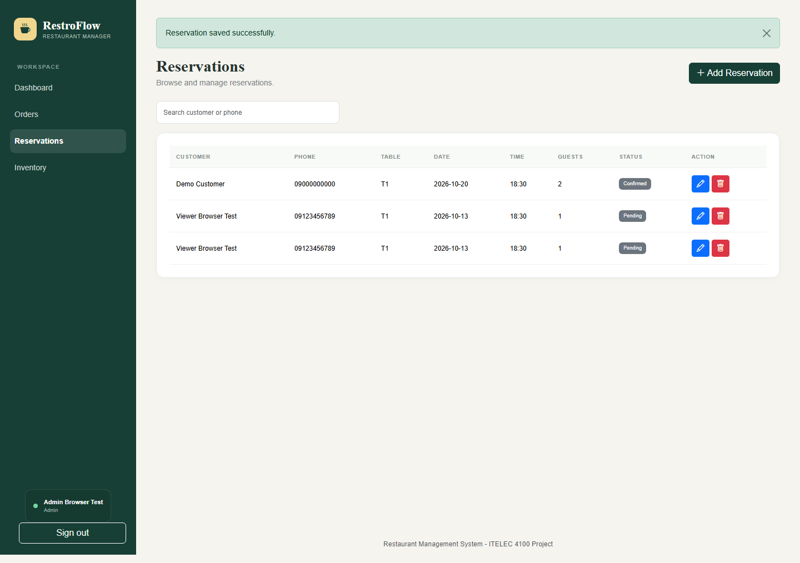

## 16. Manage inventory

Admin can add, edit, and delete inventory items. Quantity, unit, and reorder level are validated. Low Stock is displayed when quantity is less than or equal to the reorder level.

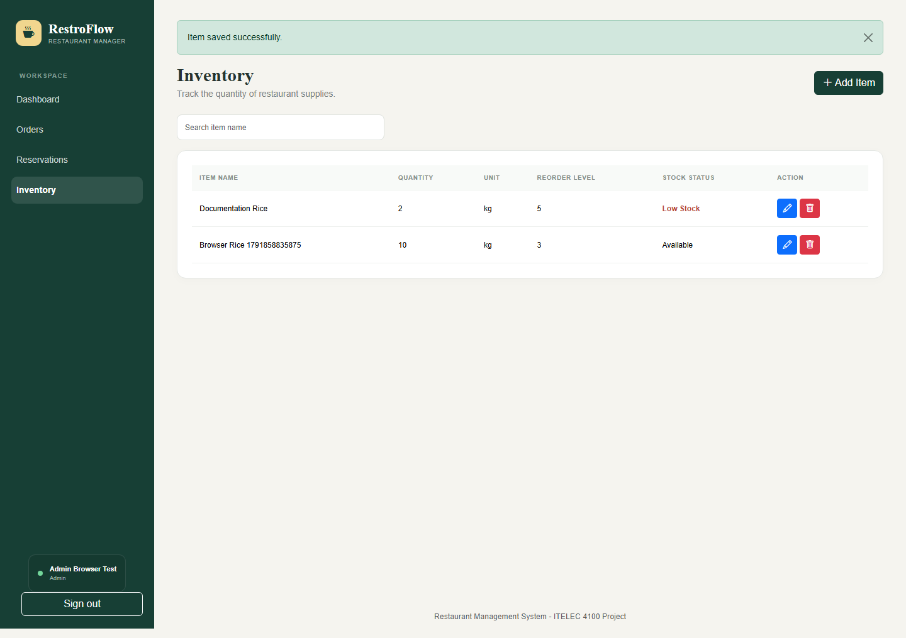

## 17. Staff inventory permissions

Staff can add and edit inventory but cannot delete. The screenshot shows the permitted controls; the backend also rejects unauthorized deletion instead of relying on hidden buttons.

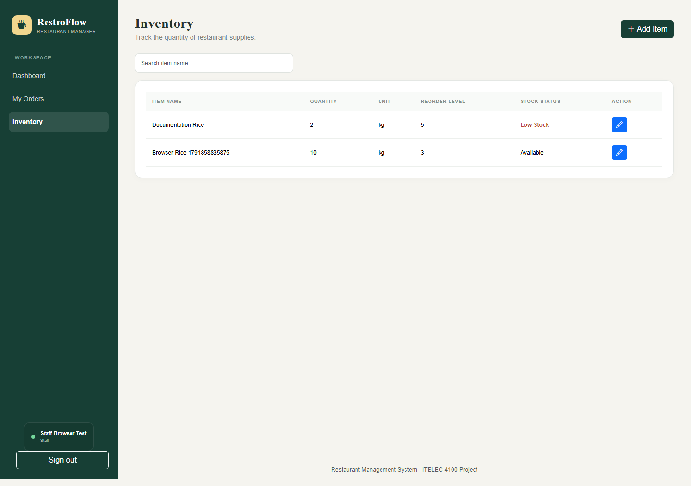

## 18. Security, validation, and known limits

Authentication uses Fortify with hashed passwords. The web middleware provides CSRF protection. React forms display validation feedback; JSON requests send the X-XSRF-TOKEN header. Spatie permissions and ownership checks enforce backend access restrictions.

Back/Forward navigation rechecks the server session. Logged-in users are redirected away from login/register screens; logged-out users cannot reopen the protected dashboard through history. Responses use no-store caching directives.

| Validation | Evidence / coverage |
| --- | --- |
| Backend tests | 26 tests and 340 assertions passed during documentation preparation. Covers auth, OTP, password reset, token reuse, CRUD, ownership, permissions, resource pages and relationships. |
| Browser regression | Two existing browser tests previously passed for authentication/CRUD/roles and Back/Forward session checks. |
| Documentation capture | The accompanying Playwright documentation scenario performs registration, OTP verification, customer order/reservation creation, admin confirmation, and staff access before capturing screens. |
| Frontend build | Production Vite build passed in the implementation validation. |

Limits: SMTP inbox delivery is not verified by these screenshots. The current reservation implementation does not establish automatic capacity/conflict prevention or payment processing; it stores requests for administrative review. Screenshots are a point-in-time demo, not production data.

## 19. Mapping to Final Project.docx.pdf

| PDF requirement | Implemented evidence |
| --- | --- |
| MVC, migrations, validation | Resource controllers + service classes + Eloquent models; migrations, foreign keys, audit timestamps; server-side validation. |
| Eloquent relationships | Explicit hasMany/belongsTo methods; eager-loaded related menu/table data; protected mass assignment. |
| Resource controllers and modular routes | Standard CRUD methods and named resource/API routes in separate order, reservation, and inventory route files. |
| React and Inertia integration | Reusable JSX components, Inertia views, shared middleware props, Blade root directives, Vite and resolvePageComponent. |
| Fortify headless authentication | Native Fortify routes and controllers with custom Inertia views; password reset; registration OTP customization. |
| Spatie RBAC and seeding | HasRoles, role/permission migrations, RolesAndPermissionsSeeder, auth/can middleware, scoped queries and conditional controls. |
| Quality and demonstration | Automated tests, build verification, presentation script, and illustrated documentation. |

Domain adaptations: RestroFlow retains its restaurant entities and project name instead of the PDF's example product/category names. Business history is preserved with appropriate delete constraints rather than cascading deletion of orders. See docs/pdf-alignment.md for the detailed file mapping.

Reproduce: php artisan test; npm run build; npx playwright test. For screenshots in PowerShell: $env:DOC_SCREENSHOTS="1"; npx.cmd playwright test tests/browser/documentation.spec.js. Rebuild this PDF with python docs/build_documentation.py (requires ReportLab).
